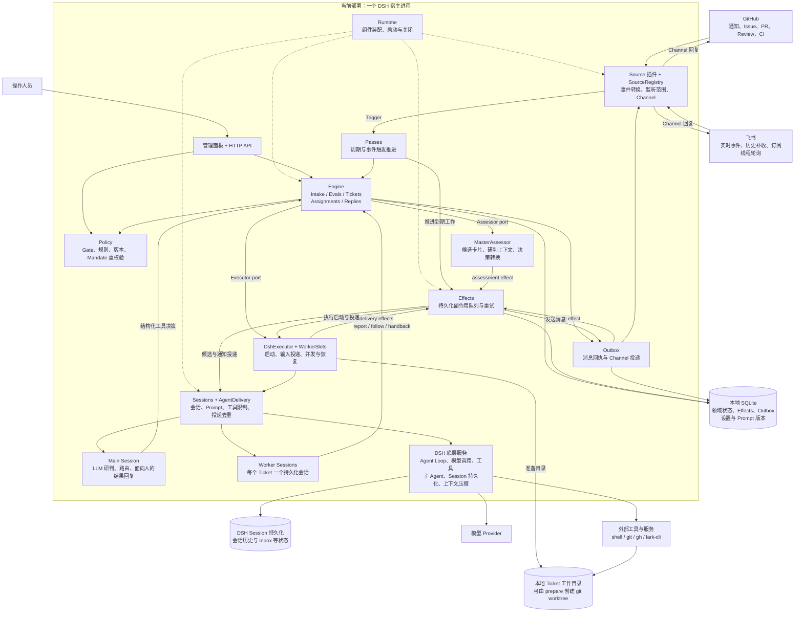
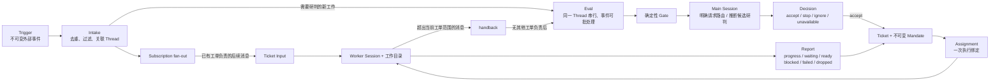
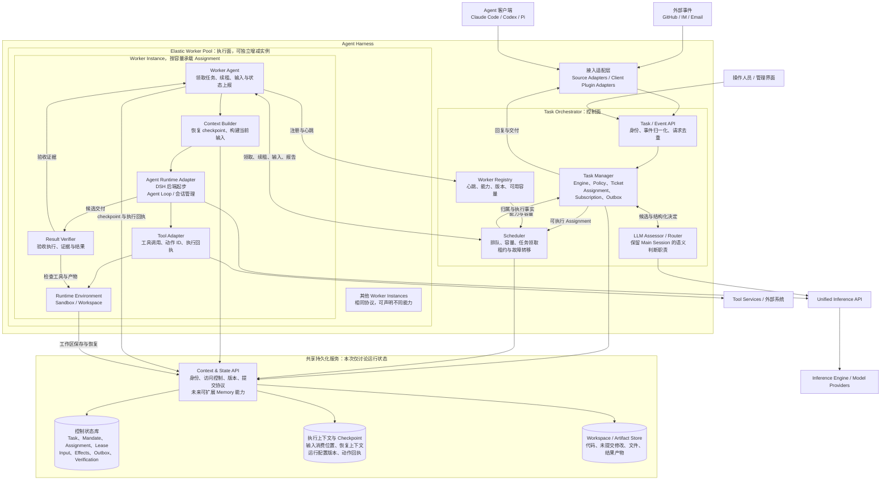
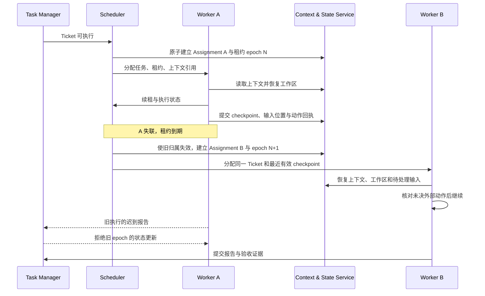

# Super Agent Harness 架构评审：当前实现与 Proposal

状态：Draft，供架构 Review；尚未确定实施方案。  
日期：2026-11-06  
代码基线：`dsh-superagent-prototype`，commit `8c32a9d`。  
目标参考：用户提供的 Super Agent Proposal 第 1 页及备注（PPT 仅保留在本地，不纳入仓库）。

## 1. 本次讨论的范围

本文聚焦 Harness：事件接入、任务与授权管理、调度、Agent 执行、上下文构建、工具运行、结果验证和故障恢复。

暂不展开长期记忆、经验提炼、Attention-native retrieval、模型训练与 RSI。为了实现 PPT 中的持续运行，仍需讨论共享任务状态和持久化 checkpoint；它们属于运行基础，不以建设完整 Memory 系统为前提。

文中明确区分两类内容：

- **当前实现**：来自仓库代码和文档的事实。
- **Proposal**：基于 PPT 提出的目标设计，尚未实现，也不是 PPT 已经确定的所有细节。

核心建议：保留 prototype 的任务领域模型，把当前依赖本地 DSH Session 的执行部分抽成可远程调度的 Worker Runtime。先形成清晰的逻辑边界，再决定部署为多少个服务。

## 2. 当前代码架构

### 2.1 系统全景

当前是一个面向单个 GitHub 仓库的 DSH bundle。主插件和 Source 插件在同一个 DSH 宿主中运行；Main Session 与 Worker Session 是宿主管理的逻辑会话，不是独立的 worker 服务。

图中的 `Effects → DshExecutor` 等箭头表示队列 handler 的调用；它们仍在同一进程内。`Runtime` 的虚线仅表示装配关系。

### 2.2 核心领域模型与执行链路

需要保留的语义：

- **Ticket 与 Assignment 分离**：工单可以经历多次执行；执行失败、重试与工单结束是不同事件。
- **Thread 与 Ticket 是多对多关系**：同一讨论可承载多项工作，工单也可跟随多个讨论。
- **上下文与授权分离**：订阅消息可以提供上下文，不自动扩大 Mandate。
- **后续消息有明确负责人**：通常先交给既有 worker；超出范围后由 worker 交回研判，避免重复接单。
- **业务完成与会话空闲分离**：有 PR 的任务在 `ready` 后仍可能等待评审、修改或 PR 关闭。

### 2.3 当前代码中各部分负责什么

| 部分 | 主要职责 | 代码入口 |
|---|---|---|
| Runtime | 组件装配、状态目录锁、初始化、关闭 | [runtime.ts](./dsh-superagent-prototype/src/app/runtime.ts) |
| Engine | 领域命令的事务入口，管理事件、决策、工单、派工与回复 | [engine.ts](./dsh-superagent-prototype/src/core/engine.ts) |
| Domain model / Ports | 数据模型和 Assessor、Executor、Repositories 等边界 | [model.ts](./dsh-superagent-prototype/src/core/model.ts)、[ports.ts](./dsh-superagent-prototype/src/core/ports.ts) |
| Policy / Assessment | 确定性准入、模型研判结果校验、授权重校验 | [policy.ts](./dsh-superagent-prototype/src/policy.ts)、[assessment.ts](./dsh-superagent-prototype/src/app/assessment.ts) |
| DshExecutor | 工作目录准备、worker 启动与唤醒、槽位、后台任务、恢复 | [dsh.ts](./dsh-superagent-prototype/src/executor/dsh.ts) |
| Sessions | DSH 会话、角色模型、Prompt／Skill 装配和工具限制 | [sessions.ts](./dsh-superagent-prototype/src/app/sessions.ts) |
| Store / Effects / Outbox | SQLite 事务、持久化待办、失败重试、消息回执 | [store.ts](./dsh-superagent-prototype/src/app/store.ts)、[effects.ts](./dsh-superagent-prototype/src/app/effects.ts)、[outbox.ts](./dsh-superagent-prototype/src/app/outbox.ts) |
| AgentDelivery | 根据稳定消息 ID，结合历史与 Inbox 去重，投递后刷新持久化 | [delivery.ts](./dsh-superagent-prototype/src/app/delivery.ts) |
| Sources | GitHub／飞书事件适配、读取上下文、回复外部讨论 | [kind.ts](./dsh-superagent-prototype/src/sources/kind.ts)、[registry.ts](./dsh-superagent-prototype/src/sources/registry.ts) |
| Role prompts / Tools | 角色分工、行为规则和结构化操作接口 | [prompts](./dsh-superagent-prototype/prompts/)、[tools](./dsh-superagent-prototype/src/app/tools/) |

### 2.4 当前能力边界

| 主题 | 当前已实现 | 距离 PPT 的差异 |
|---|---|---|
| 持续运行 | Source 持续接收事件，工单可等待和恢复 | 依赖单个宿主和本地持久化状态 |
| 并发执行 | 多个 Worker Session、本地槽位、人的后续消息可使用额外槽位 | 没有远程 worker 注册、心跳或分布式任务归属 |
| 故障恢复 | 同一 Session／目录上重建 Assignment，重投未被会话接收的消息 | 不是跨机器、跨 Runtime 的完整 checkpoint 恢复 |
| 可靠投递 | Effects／Outbox 保存后重试，内部消息去重，Channel 适配器提供幂等发送 | 任意 shell／外部工具动作没有统一事务保证 |
| 上下文构建 | Prompt 拼装、事件卡片、截断后按引用读取、DSH 上下文管理 | 没有独立、可移植的 Context Builder 与 checkpoint 合约 |
| 执行环境 | 每个工单一个目录，工具集合受限，使用账号包装命令 | 目录和命令包装不构成强隔离；执行使用操作系统用户权限 |
| 结果验证 | worker 自检和报告、字段校验、PR 归属检查 | 没有独立执行验收的 Result Verifier |
| 模型调用 | 通过 DSH 模型服务，主 Session 与 worker 可配置不同模型 | 没有由本项目定义的统一推理服务边界 |

当前 `ready` 表示 worker 报告已完成相关检查，不能等同于系统已经独立验收。合并条件、技术范围判断等也有相当部分由 Prompt 约定。

## 3. Proposal：面向 PPT 的目标架构

### 3.1 设计原则

1. **任务持续存在，执行实例可替换。** Ticket 的身份和授权不依附于某个 worker 进程。
2. **任务控制与执行分开。** 控制面管理状态和归属，worker 执行任务并提交事实与产物。
3. **运行状态可恢复。** worker 本地缓存丢失后，可从持久化 checkpoint 和工作区产物继续。
4. **上下文存储与计算独立扩展。** 共享服务不要求与 worker 部署在同一机器。
5. **执行后端通过显式合约接入。** 第一个后端沿用 DSH；其他后端按能力适配。
6. **先明确边界，再拆部署。** 下图是逻辑架构，不意味着每个框都必须成为微服务。

### 3.2 目标全景

图中将共享服务写为 `Context & State API`，对应 PPT 的 `Context & Memory API` 中运行状态部分。名称、协议以及是否共用一个对外端点，均可在 review 后调整。

控制状态、执行上下文和产物是不同类型的数据。它们可以先由一个服务提供，但必须有明确的写入权和版本关系，不能成为多个进程随意覆盖的共享字典。

### 3.3 组件职责与状态归属

| 组件 | 负责 | 状态归属与限制 |
|---|---|---|
| Task Manager | 授权、业务状态、输入路由、生命周期、结果交付 | 工单领域状态的权威写入者；worker 提交报告，不直接改 Ticket |
| LLM Assessor / Router | 判断请求意图、关联工单、研判推断候选 | 提议结构化决定，由 Task Manager 校验；不负责机器容量调度 |
| Scheduler | 执行排队、选择符合能力的 worker、租约和失联处理 | 通过受控事务更新执行归属；与 Task Manager 保持一致的 Assignment 状态 |
| Worker Registry | 记录 worker 能力、版本、心跳和容量 | 在线状态不是任务完成的依据；重启后需重新注册 |
| Worker Agent | 接受 Assignment、续租、接收输入、上报执行事实 | 本地可有缓存；有效执行归属必须由控制面确认 |
| Context Builder | 从任务、输入与 checkpoint 构建本次执行上下文 | 记录使用的 checkpoint 和输入位置；按权限访问 |
| Agent Runtime Adapter | 驱动具体 Agent Loop，接收新输入、取消、导出恢复信息 | 先适配 DSH；不假设所有后端的会话格式完全相同 |
| Tool Adapter | 调用工具，记录动作身份、结果与外部回执 | 写操作需考虑重试及归属有效性；无法幂等的动作需核对状态 |
| Result Verifier | 按工单验收要求执行检查并保存证据 | 逻辑上独立于 worker 的自述；可在同一实例内运行 |
| Context & State Service | 保存、读取并授权访问运行状态、上下文和版本化产物引用 | 不在本轮实现长期记忆与经验学习 |
| Unified Inference API | 提供模型调用合约、配置标识和调用追踪 | DSH 后端需要适配；其他 Agent 后端是否允许替换模型通道需单独确认 |

这里的 Sandbox 是目标执行边界，具体隔离方式尚未决定。worker 的工具限制、租约校验和操作系统／容器隔离分别解决不同问题。

### 3.4 客户端接入与执行后端是两个不同接口

PPT 将 Claude Code、Codex、Pi 画为 Plugin adapters 的客户端接入点。本文保留这一关系：它们可以提交任务、传入上下文、查询结果，不因此自动成为 worker。

如果还希望它们作为执行后端，需要额外实现 Runtime Adapter，确认以下能力：

- 新建或恢复任务执行，注入后续输入，取消执行。
- 获取结构化状态、工具动作、产物和可恢复上下文。
- 对接身份与权限、运行配置和模型调用链路。

因此，“支持 Codex 插件接入”与“支持将一个运行中的 DSH 任务迁移给 Codex 执行”是两项不同能力。后者不作为首版默认承诺。

## 4. 持久化与跨 Worker 恢复

### 4.1 Checkpoint 最小内容

| 类别 | 建议内容 | 作用 |
|---|---|---|
| 任务绑定 | Ticket ID、Assignment ID、执行 epoch、checkpoint 版本 | 确认任务、执行归属及有效版本 |
| 授权与配置引用 | Mandate、Policy 版本、Prompt／Skill／Runtime／模型配置版本 | 明确恢复时的约束及配置来源 |
| 输入消费位置 | 输入 ID、已投递／进入会话／完成处理的位置或回执 | 避免丢失或误判后续请求 |
| 可恢复上下文 | 会话引用或可重建上下文、当前进度、待完成事项 | 让替代 worker 理解当前工作 |
| 工作区与产物 | 仓库与 commit、未提交修改、必要文件或快照引用 | 恢复实际工作现场 |
| 外部动作账本 | Action ID、动作状态、结果、PR 等外部资源引用 | 恢复前核对动作是否已经发生 |
| 验收状态 | 检查结果及其对应的产物版本 | 避免把旧版本检查结果用于新产物 |

上述字段是合约草案，不要求一次存为一个大文件。任务数据库、会话存储和产物存储之间需要有一致的版本引用。

配置版本被记录不表示恢复时总要重放旧配置：恢复应校验当前授权，并明确哪些配置沿用、哪些更新。授权收紧如何影响执行，需要形成明确规则。

### 4.2 跨 Worker 接手流程

恢复的目标是“从最近持久化边界继续完成任务”，不是恢复原进程的内存、程序计数器或正在运行的 shell。不可迁移的进程需要终止、重建或单独托管。

**执行归属失效与外部动作失效需要分别处理。** 控制面拒绝旧报告，并不能阻止旧 worker 继续用已有凭据调用外部系统。目标设计应将关键写操作纳入可校验归属的工具网关或受限能力凭据；仍可绕过网关的动作不能声称受到完整保护。

跨系统也不能默认保证 exactly-once：优先使用幂等键、持久化回执和恢复时核对；对“远端已执行、本地未确认”的动作，先查明再重试。

## 5. 当前组件到 Proposal 的映射

| 当前实现 | Proposal 中的位置 | 演进判断 |
|---|---|---|
| SourceKind / SourceRegistry / Channel | 接入适配层 | 保留抽象和现有适配，逐步补充其他入口 |
| Engine / Ticket / Mandate / Subscription | Task Manager | 保留核心语义，扩展远程执行归属与恢复语义 |
| Main Session / MasterAssessor | LLM Assessor / Router | 保留语义判断职责，从控制服务的本地会话依赖中抽出 |
| Effects / Passes | 控制面的可靠工作推进 | 保留事务性入队语义，扩展远程交付和领取机制 |
| Outbox / AgentDelivery | 外部回复与内部消息可靠投递 | 保留回执和去重思路，新增跨进程协议 |
| DshExecutor | Scheduler、Worker Agent、DSH Runtime Adapter | 当前职责需要拆分，是主要重构点 |
| WorkerSlots | Scheduler 的容量与优先级策略 | 保留调度意图，替换进程内计数实现 |
| Sessions / Prompts | Runtime Adapter 与 Context Builder | 保留角色、版本和工具装配能力，定义恢复合约 |
| Store | 控制状态持久化与共享状态服务实现 | 保留数据语义，重新确定存储接口和事务边界 |
| 本地 Ticket 目录 | Worker Workspace + Artifact Store | 增加可恢复产物与快照机制 |
| worker 自检与报告 | Result Verifier 的输入 | 增加独立验收执行、证据和产物版本关联 |
| DSH 模型服务 | Unified Inference API 的首个对接路径 | 验证可接入点，不重复实现模型服务 |
| 无对应组件 | Worker Registry、租约、epoch 校验 | 新增能力 |

特别注意：当前 `Repositories` 是同步接口，Engine 在同步事务里调用它。不能直接把方法实现替换成 HTTP 或异步数据库访问。需要选择将领域命令与事务留在状态服务中，或调整仓储与事务执行模型；这一点属于后续实现设计。

当前实例还固定面向一个 GitHub 仓库。如果首版保留这一部署单元，可先不改变任务语义；若目标是一套控制面服务多个项目，则必须增加 Project／Workspace 范围和账号、规则、目录的归属，不能只删除单仓库配置限制。

## 6. 建议首版架构边界

建议首版验证以下组合，具体改动步骤在架构 review 后再展开：

- 一个逻辑控制面，保留现有事件、授权、工单和回复语义。
- 一个共享运行状态服务；物理存储选型待定。
- 两个可独立停止、重启的 DSH worker 实例。
- 相同 Runtime 之间的 checkpoint 与工作区恢复。
- 明确的 Assignment 租约及旧执行拒绝机制。
- 一个最小 Result Verifier，记录检查对应的实际产物版本。

关键验证场景：worker A 处理中断后，worker B 接手同一 Ticket，恢复必要工作区和输入，核对已发生的外部动作，并继续完成可验收交付。

该场景成立后，再扩展更多 worker、客户端入口和异构 Runtime。弹性容量可以先人工增减，自动扩缩容策略不是验证执行可替换性的前提。

## 7. 本轮 Review 的重点

| 待讨论问题 | 本文建议 |
|---|---|
| 产品范围：先做研发 Agent，还是立即支持通用任务？ | 先保留研发任务和单仓库部署单元，验证核心运行机制 |
| 是否接受控制面与 worker 的逻辑拆分？ | 接受；首版不要求控制面内部全部拆微服务 |
| DSH 是首个执行后端，还是要重写 Agent Loop？ | 先沿用 DSH，通过 Runtime Adapter 明确边界 |
| 恢复目标是同类 Runtime 接手，还是任意 Agent 互换？ | 先实现同类 Runtime；异构接手另定能力与上下文合约 |
| workspace 如何恢复？ | 必须覆盖未提交修改和必要非 Git 文件；共享文件系统或快照方案待选 |
| Context & State 服务是否独立于长期 Memory 建设？ | 独立推进，保留未来接入接口 |
| 独立验收具体检查什么？ | 首版绑定研发任务的明确验收项，避免只依赖 worker 的 `ready` 自述 |

本轮产物用于确认目标组件、责任与边界。服务选型、API 字段和代码拆分顺序，待 review 后形成下一份实施设计。
